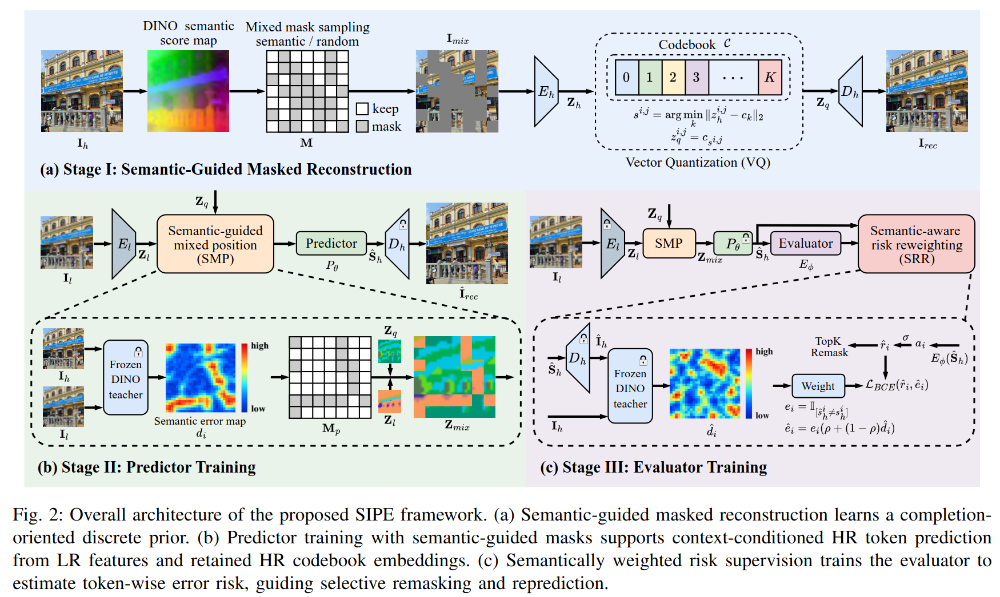
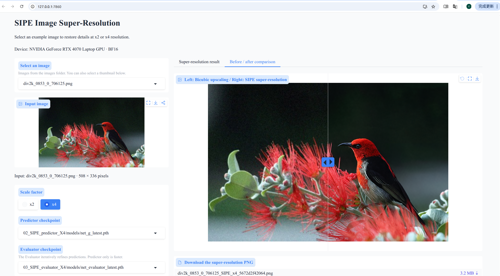
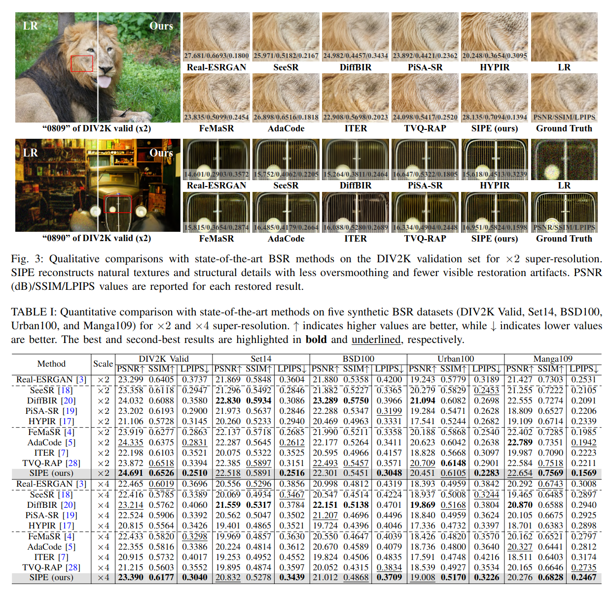
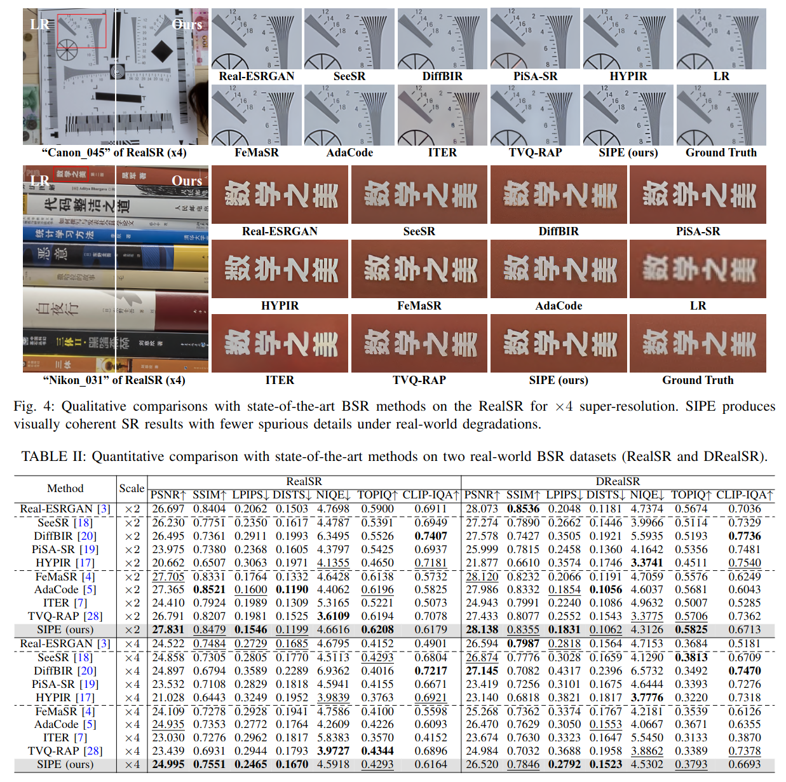

# Semantic-Guided Iterative Token Prediction and Evaluation for Blind Image Super-Resolution (SIPE) 

This is the official PyTorch implementation of SIPE.



[//]: # (**Figure 2. Overall architecture of SIPE.** The framework consists of semantic-guided masked reconstruction, Predictor training, and Evaluator training.)

## :runner: TODO

- ✅ Provide training code and configurations for the VQ prior, Predictor, and Evaluator.
- ✅ Support x2 and x4 super-resolution with optional Evaluator refinement.
- ✅ Provide a Gradio demo with image preview, before/after comparison, and PNG download.
- ✅ Provide PSNR, SSIM, and LPIPS evaluation scripts.
- ✅ Provide pretrained checkpoint download links.
- [ ] Add SIPE publication information.

## :wrench: Dependencies and Installation

### Step 1: Create the Conda environment

The provided [environment.yml](environment.yml) specifies Python `3.10.13`, PyTorch `2.1.0`, TorchVision `0.16.0`, CUDA `12.1`, and Gradio `6.17.3`. Ubuntu `20.04` is recommended.

Clone or download the project into a folder named `SIPE`, then create and activate the environment from this directory:

```bash
cd /path/to/SIPE
conda env create -f environment.yml
conda activate sipe
```

### Step 2: Install the local BasicSR package

Install the project's BasicSR implementation with `--no-deps` to preserve the dependency versions restored above.

```bash
python -m pip install -e . --no-deps --no-build-isolation
```

The semantic encoder ([DINOv2](https://github.com/facebookresearch/dinov2)/[DINOv3](https://github.com/facebookresearch/dinov3)) provides frozen semantic guidance during training and is selected through the YAML configuration. Prepare the corresponding pretrained weights and local repository or Torch Hub cache before offline training. The semantic encoder is not required for BSR inference.

## :rocket: Quick Inference

### Step 1: Prepare pretrained checkpoints

Download the pretrained checkpoints from [Baidu Netdisk](https://pan.baidu.com/s/1zboF01WbENpAMmYbqbWxjA) (extraction code: `yw8a`). Place the downloaded weights under `experiments/` using the following layout:

```text
experiments/
├── 01_SIPE_SwinVQGAN_HQ_stage_DINOv2SemVQ/
│   └── models/
│       └── net_g_latest.pth
├── 02_SIPE_predictor_X2/
│   └── models/
│       └── net_g_latest.pth
├── 02_SIPE_predictor_X4/
│   └── models/
│       └── net_g_latest.pth
├── 03_SIPE_evaluator_X2/
│   └── models/
│       └── net_evaluator_latest.pth
└── 03_SIPE_evaluator_X4/
    └── models/
        └── net_evaluator_latest.pth
```

| Model | Description | Required for inference |
| --- | --- | --- |
| SwinVQGAN prior | HQ image tokenizer, codebook, and decoder trained in Stage 1. | Included in a complete Stage-2 Predictor checkpoint. |
| Predictor, x2 / x4 | Predicts HR token IDs from the LR image and reconstructs the SR image. | Yes; select the matching scale. |
| Evaluator, x2 / x4 | Evaluates proposed token changes during iterative refinement. | Optional; select a compatible Predictor/Evaluator pair. |

### Step 2: Run the Gradio demo

```bash
python app.py
```

Open `http://127.0.0.1:7860` in your browser:

1. Select an example from the dropdown or the thumbnails in `images/`, or upload your own image in **Input image**.
2. Select **x2** or **x4**, then choose the corresponding Predictor and Evaluator checkpoints.
3. Adjust the refinement steps and tile settings if needed, then click **Run Super-Resolution**.
4. View the restored image, compare it with bicubic upscaling, and download the PNG result.



Choose **None (Predictor only, faster)** in the Evaluator dropdown to use one-shot Predictor inference.

The demo scans `net_g*.pth` and `net_evaluator*.pth` under the scale-specific experiment directories, with `latest` checkpoints listed first. It reads configuration files saved in those experiment directories when available, and otherwise uses `options/`.

```bash
# Use a specific device and port.
python app.py --device cuda --port 7861

# Run on CPU.
python app.py --device cpu

# Use custom image and checkpoint directories, and keep PNG results in an output directory.
python app.py --images-dir /path/to/images \
  --experiments-dir /path/to/experiments \
  --output-dir /path/to/results
```

### Step 3: Run sipe inference

For x2 BSR with iterative refinement (`--num_iter` defaults to `4`):

```bash
python inference_sipe.py \
  --opt options/03train_SIPE_evaluator_X2.yml \
  --predictor_path experiments/02_SIPE_predictor_X2/models/net_g_latest.pth \
  --evaluator_path experiments/03_SIPE_evaluator_X2/models/net_evaluator_latest.pth \
  --input images --output results_sipe/x2
```

For x4 BSR with iterative refinement (`--num_iter` defaults to `4`):

```bash
python inference_sipe.py \
  --opt options/03train_SIPE_evaluator_X4.yml \
  --predictor_path experiments/02_SIPE_predictor_X4/models/net_g_latest.pth \
  --evaluator_path experiments/03_SIPE_evaluator_X4/models/net_evaluator_latest.pth \
  --input images --output results_sipe/x4
```

With `n` refinement iterations, set `--num_iter n` (replace `n` with the desired iteration count):

```bash
python inference_sipe.py \
  --opt options/03train_SIPE_evaluator_X4.yml \
  --predictor_path experiments/02_SIPE_predictor_X4/models/net_g_latest.pth \
  --evaluator_path experiments/03_SIPE_evaluator_X4/models/net_evaluator_latest.pth \
  --num_iter n \
  --input images --output results_sipe/x4
```

If GPU memory is insufficient, enable tiled inference with `--tile 128`. The tile size is measured in LR pixels; reduce it to `64` if needed:

```bash
python inference_sipe.py \
  --opt options/03train_SIPE_evaluator_X4.yml \
  --predictor_path experiments/02_SIPE_predictor_X4/models/net_g_latest.pth \
  --evaluator_path experiments/03_SIPE_evaluator_X4/models/net_evaluator_latest.pth \
  --num_iter n \
  --tile 128 \
  --input images --output results_sipe/x4
```

To disable iterative refinement, omit `--evaluator_path` or set `--num_iter 0`:

```bash
python inference_sipe.py \
  --opt options/02train_SIPE_predictor_X2.yml \
  --predictor_path experiments/02_SIPE_predictor_X2/models/net_g_latest.pth \
  --input images --output results_sipe/x2_predictor
```

## 🚂 Training

### Step 1: Prepare training and validation datasets

Please follow the dataset preparation described in [FeMaSR](README-FeMaSR.md#dataset), [AdaCode](https://github.com/kechunl/AdaCode), and [ITER](https://github.com/chaofengc/ITER). Crop 512 x 512 HR patches and generate paired x2/x4 LR training images using `degradation_bsrgan` from [BSRGAN](https://github.com/cszn/BSRGAN). For synthetic testing, generate LR images using `degradation_bsrgan_plus`.

The synthesized training dataset and DIV2K Valid test dataset can be downloaded from [Hugging Face](https://huggingface.co/datasets/chaofengc/ITER). For real-world evaluation, download [RealSR](https://github.com/csjcai/RealSR#dataset) and [DRealSR](https://github.com/xiezw5/Component-Divide-and-Conquer-for-Real-World-Image-Super-Resolution#dataset) from their official dataset pages.

An example dataset layout is:

```text
datasets/
├── train/
│   ├── HQ_sub/
│   │   └── 0001.png
│   ├── LQ_sub_X2/
│   │   └── 0001.png
│   └── LQ_sub_X4/
│       └── 0001.png
└── valid/
    ├── HR/
    │   └── 0801.png
    ├── LR_X2/
    │   └── 0801.png
    └── LR_X4/
        └── 0801.png
```

### Step 2: Configure the three training stages

| Stage | Configuration | Initialization |
| --- | --- | --- |
| 1. HQ VQ prior | [01train_SIPE_SwinVQGAN_HQ_stage.yml](options/01train_SIPE_SwinVQGAN_HQ_stage.yml) | Train the HQ tokenizer, codebook, and decoder. |
| 2. Predictor, x2 | [02train_SIPE_predictor_X2.yml](options/02train_SIPE_predictor_X2.yml) | Set `path.pretrain_network_hq` to the Stage-1 generator checkpoint. |
| 2. Predictor, x4 | [02train_SIPE_predictor_X4.yml](options/02train_SIPE_predictor_X4.yml) | The template transfers the x2 Predictor through `path.pretrain_network_g`, including its VQ prior. |
| 3. Evaluator, x2 | [03train_SIPE_evaluator_X2.yml](options/03train_SIPE_evaluator_X2.yml) | Set `path.pretrain_network_g` to the complete x2 Stage-2 checkpoint. |
| 3. Evaluator, x4 | [03train_SIPE_evaluator_X4.yml](options/03train_SIPE_evaluator_X4.yml) | Load the x4 Stage-2 Predictor; the template initializes the Evaluator from x2. |

### Step 3: Run training commands

The following commands use four GPU processes, matching the supplied configurations.

Train the HQ VQ prior:

```bash
accelerate launch --multi_gpu --num_processes 4 basicsr/train.py \
  -opt options/01train_SIPE_SwinVQGAN_HQ_stage.yml
```

Train the x2 and x4 Predictors:

```bash
accelerate launch --multi_gpu --num_processes 4 basicsr/train.py \
  -opt options/02train_SIPE_predictor_X2.yml

accelerate launch --multi_gpu --num_processes 4 basicsr/train.py \
  -opt options/02train_SIPE_predictor_X4.yml
```

Train the x2 and x4 Evaluators:

```bash
accelerate launch --multi_gpu --num_processes 4 basicsr/train.py \
  -opt options/03train_SIPE_evaluator_X2.yml

accelerate launch --multi_gpu --num_processes 4 basicsr/train.py \
  -opt options/03train_SIPE_evaluator_X4.yml
```

For one GPU, set `num_gpu: 1` in the selected configuration and run:

```bash
python basicsr/train.py -opt options/03train_SIPE_evaluator_X2.yml
```

Adjust `batch_size_per_gpu` and `train.gradient_accumulation_steps` for the available memory. With gradient accumulation enabled, iteration and logging-frequency settings are interpreted as optimizer-update counts by the trainer.

## :computer: Results

### Synthetic datasets



### Real-world datasets



### 📊 Reproduce the evaluation

#### Step 1: Generate SR images

Prepare the corresponding HR images with matching stems and `.png` extensions; the metric script expects the same relative filename and extension in the HR and SR folders.

#### Step 2: Calculate metrics with pyiqa

For x2 results:

```bash
python test_paired_metrics.py \
  --gt datasets/valid/HR --pred results_sipe/x2 \
  --crop_border 2 --test_y_channel \
  --csv_path results_sipe/x2_metrics.csv
```

For x4 results:

```bash
python test_paired_metrics.py \
  --gt datasets/valid/HR --pred results_sipe/x4 \
  --crop_border 4 --test_y_channel \
  --csv_path results_sipe/x4_metrics.csv
```

The commands above calculate PSNR, SSIM, and LPIPS. Add `--all_metrics True` to also calculate TOPIQ-FR-PIPAL, DISTS, NIQE, and CLIP-IQA.

## :book: Citation

## :handshake: Acknowledgements

This project is based on [BasicSR](https://github.com/XPixelGroup/BasicSR), [FeMaSR](https://github.com/chaofengc/FeMaSR), and [ITER](https://github.com/chaofengc/ITER).

## :postbox: Contact

If you have any questions, feel free to approach me at jinchuan@tongji.edu.cn
